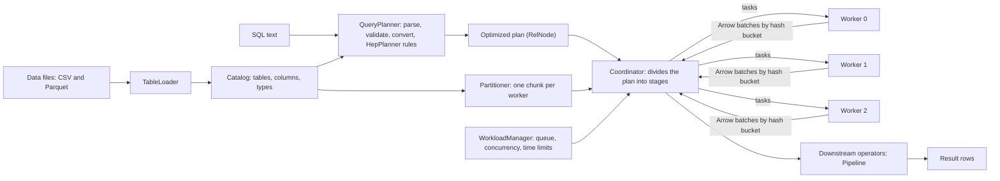
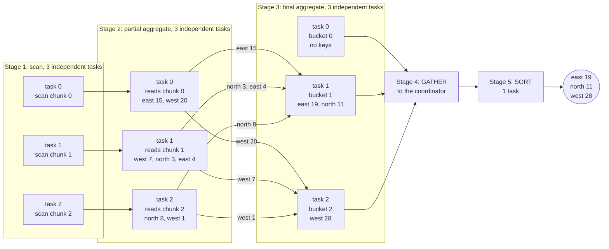
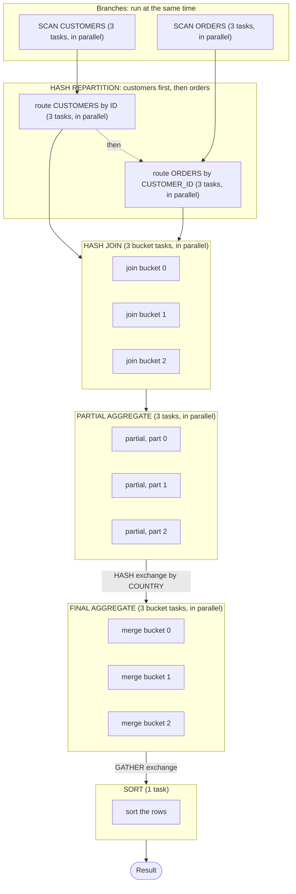

# How a Distributed Query Engine Works: A Hands-On Skeleton

This article explains how a distributed SQL query engine turns one query into work for many machines. The central idea is to split the work into independent parts, so that several workers can run them at the same time without waiting for each other. The article shows that idea in a small Java project you can compile, run, and test. The project plans SQL with Apache Calcite's rule-based planner (HepPlanner), splits the plan into stages, runs partial aggregation on workers that return Apache Arrow batches to a coordinator, and passes the results to downstream operators. It is a teaching skeleton. Threads stand in for machines, and most of what a production system needs is left out, but the shape of the execution matches real clusters.

How to read it: [The big idea](#the-big-idea-split-the-work-into-independent-parts) and [The main flow, step by step](#the-main-flow-step-by-step) are enough to understand how a query runs on several workers. [Parallelism in detail](#parallelism-in-detail) explains the mechanism behind it. The sections after that each go deeper into one piece: planning, exchanges, batches, joins, testing, and limits.

## Table of contents

- [The problem](#the-problem)
- [The big idea: split the work into independent parts](#the-big-idea-split-the-work-into-independent-parts)
- [Design diagram](#design-diagram)
- [The main flow, step by step](#the-main-flow-step-by-step)
- [Parallelism in detail](#parallelism-in-detail)
- [Reading the data from storage](#reading-the-data-from-storage)
- [From SQL to a logical plan](#from-sql-to-a-logical-plan)
- [From logical plan to stages](#from-logical-plan-to-stages)
- [Exchanges and hash buckets](#exchanges-and-hash-buckets)
- [Execution with columnar batches](#execution-with-columnar-batches)
- [Joins and multi-table plans](#joins-and-multi-table-plans)
- [Running and testing the skeleton](#running-and-testing-the-skeleton)
- [SQL with Calcite and random query testing](#sql-with-calcite-and-random-query-testing)
- [Operators: consuming query results](#operators-consuming-query-results)
- [Limits and workload management](#limits-and-workload-management)
- [How the skeleton maps to real engines](#how-the-skeleton-maps-to-real-engines)
- [What the skeleton leaves out](#what-the-skeleton-leaves-out)
- [Where to go next](#where-to-go-next)
- [References](#references)
## The problem

A single machine can only scan and aggregate so much data in a reasonable time. Once a table grows into billions of rows spread over many files, the bottleneck is no longer the CPU of one server. It is the amount of data that one server has to read.

Distributed engines solve this by splitting the data into partitions, placing those partitions on several worker nodes, and sending each node the work it can do locally. Each node reduces its own share of the data, and only the reduced results travel across the network. MapReduce popularized this pattern at scale (Dean and Ghemawat, 2004), and modern SQL engines refine it with richer operators and pipelining.

The example for the whole article is one query over one small table:

```sql
SELECT REGION, SUM(SALES) AS TOTAL_SALES
FROM SALES
GROUP BY REGION
ORDER BY REGION;
```

| row | REGION | SALES |
|---|---|---|
| 1 | east | 10 |
| 2 | west | 20 |
| 3 | east | 5 |
| 4 | west | 7 |
| 5 | north | 3 |
| 6 | east | 4 |
| 7 | north | 8 |
| 8 | west | 1 |

The answer is east 19, north 11, and west 28. The `GROUP BY` is the part that can run on several workers, and the `ORDER BY` is there on purpose, because it is a step that cannot.

## The big idea: split the work into independent parts

Running a query on several workers only helps if the work can be cut into pieces that do not wait for each other. This article calls such a piece a task. Two tasks are independent when neither needs a result that the other produces. Independent tasks read their own input and write their own output, so they can run in any order, or all at once, on different threads or machines, and the final answer does not change.

Everything else in the engine serves this idea. The engine arranges the work so that most of it sits in groups of independent tasks, and so that the unavoidable dependencies are limited to a few well-defined points between those groups. A group of independent tasks that do the same operation is a stage, and the point where data moves from one stage to the next is an exchange.

There are three ways to cut a query into independent parts.

**By partition.** The table is cut into chunks, one per worker. An operator that handles each row on its own (filter, project), or that can summarize a chunk without seeing the rest (partial aggregate), runs once per chunk. The chunks do not overlap, so these tasks never touch the same data.

**By bucket.** Some operators need every row with the same key in one place. A final aggregate needs all the states for `east`, and a join needs the rows from both inputs that carry the same key. A hash exchange regroups the rows by key into buckets. After that, each bucket can be processed alone, because rows in different buckets have different keys and never interact.

**By branch.** The two inputs of a join do not depend on each other, so the engine runs them at the same time.

Two things cannot be cut. A global sort needs all the rows in one place, so it is a single task. And a stage cannot start before the stage that feeds it has finished, so stages run one after another. The point where the engine waits for a whole stage is called a barrier.

| Operator | What each task needs | Independent parts | Exchange in front of it |
|---|---|---|---|
| Scan | its own partition | one task per partition | none |
| Filter, project | one row at a time | one task per partition | none |
| Partial aggregate | its own partition | one task per partition | none (its output is routed by key afterwards) |
| Final aggregate | every state for its keys | one task per bucket | HASH on the group key |
| Hash join | the matching keys from both inputs | one task per bucket | HASH on the join key, for both inputs |
| Sort, limit | all rows | a single task | GATHER |

To decide whether two tasks can run at the same time, ask what each one reads and writes. If neither reads what the other writes, they are independent. Inside a stage this is true by construction. Between stages it is never true, and that is why exchanges and barriers exist.

In the code, the unit of independence is one entry of `Dataset.parts()`. Each entry is the input of exactly one task in the next stage (see [From logical plan to stages](#from-logical-plan-to-stages)).

## Design diagram

The diagram shows the components and how data moves between them. Mermaid renders it on GitHub and in most IDEs. Arrows show data flow, and the labels name what travels along each one.



In this skeleton the coordinator is also where the exchange happens: it collects each worker's batches and hands each bucket's batches to the task that merges that bucket. In a real cluster the workers would send batches directly to each other.

## The main flow, step by step

This section follows one query through the engine, using the 8-row table and 3 workers. The query is the one from the first section:

```sql
SELECT REGION, SUM(SALES) AS TOTAL_SALES FROM SALES GROUP BY REGION ORDER BY REGION
```

### Terms used below

| Term | Meaning in this skeleton |
|---|---|
| Table | A set of rows with named, typed columns, loaded from a file into the catalog. |
| Partition | One worker's share of a table. The table is cut into contiguous chunks, one per worker. |
| Worker | A `WorkerNode` object, one per executor. It owns a memory budget and labels the log lines. It is not a thread. Tasks run on a shared pool of threads, with as many threads as workers. |
| Task | One unit of work for one partition or one bucket, such as a partial aggregate over one partition. |
| Stage | A group of tasks that do the same operation, such as all the partial aggregates. Stages run one after another. |
| Exchange | The move of rows between two stages. GATHER sends every row to the coordinator. HASH sends each row to the bucket chosen by its key, so that all rows with the same key arrive in one place. |
| Bucket | One of the destinations of a HASH exchange. Each bucket is merged by one task. |
| State | The partial result of an aggregate for one group, held by one task. For SUM it is a running total, for COUNT a running count, and for MIN or MAX the smallest or largest value seen so far. A state is a few numbers, not the group's rows. |
| Barrier | The point where the coordinator waits for every task of a stage before it starts the next stage. In the code it is `Exchange.gather`. |
| Coordinator | The component that divides the plan into stages, submits the tasks, and passes results through the exchanges. |

### Step 0: load and plan

The files are read into a catalog first, one table per file. The planner then parses the SQL and checks it against the catalog. Calcite converts it into a tree of operators, and the HepPlanner applies its rewrite rules. The result is an optimized plan. This part runs once, on the main thread, and nothing is distributed yet.

### Step 1: partition and scan

`Partitioner.partition` cuts each table into one chunk per worker. For the sales table with 3 workers, the chunks are the first 3 rows, the next 3, and the last 2:

- Worker 0 holds east 10, west 20, east 5.
- Worker 1 holds west 7, north 3, east 4.
- Worker 2 holds north 8, west 1.

No row is copied or moved at this point. Each worker simply owns its chunk.

Then the scan runs as the first stage. `Coordinator.scan` submits one task per partition, and each task reads its own chunk through its own worker (`WorkerNode.scan`). The three tasks run at the same time, and `SCAN SALES x3` in the log means three scan tasks. Even a query that is nothing but a scan, such as `SELECT * FROM SALES`, runs this way: three tasks, one per chunk, and the coordinator concatenates their rows. In a real engine each scan task would read its own file splits, and here it returns the chunk that the partitioner already cut.

### Step 2: partial aggregate, one task per partition

Once the scan stage has finished, the coordinator submits three more tasks, one per partition. Each task reads only its own chunk and computes one state per region, without talking to any other task:

| Task | Reads | Writes (partial states) |
|---|---|---|
| 0 | east 10, west 20, east 5 | east 15, west 20 |
| 1 | west 7, north 3, east 4 | west 7, north 3, east 4 |
| 2 | north 8, west 1 | north 8, west 1 |

Like the scan tasks, these are independent of each other. No task reads anything that another task writes, so the three can run at the same time. A state holds one number per aggregate in the select list, not the rows of the group, and that is why distributed aggregation is cheap: the 8 input rows became 7 states, and only the states cross to the next stage.

### Step 3: hash exchange, route each state to its bucket

The states must reach whoever will add them up. Here the exchange is HASH on the group key. The rule is:

```text
bucket = floorMod(hash(key), number of buckets)
```

With 3 buckets, the code gives `east` bucket 1, `west` bucket 2, and `north` bucket 1. Every task applies the same rule to the key alone, so every state for `east` goes to bucket 1, whichever task produced it. Bucket 0 gets no key at all, which is normal when 3 keys are spread over 3 buckets.

The routing is a per-state computation inside each partial-aggregate task (`WorkerNode.partialBuckets`). Each task sorts its states into one Arrow batch per bucket, so the data moves once, in the form of 3 batches per task:

| Bucket | from task 0 | from task 1 | from task 2 |
|---|---|---|---|
| 0 | (empty) | (empty) | (empty) |
| 1 | east 15 | north 3, east 4 | north 8 |
| 2 | west 20 | west 7 | west 1 |

The coordinator waits until all three tasks have finished (the barrier), and then hands each bucket's three batches to the task that merges that bucket.

### Step 4: final aggregate, one task per bucket

One task runs per bucket. It reads only the batches of its own bucket, adds up the states for each group, and produces the output rows:

- Bucket 1 adds east 15 + 4 = 19 and north 3 + 8 = 11.
- Bucket 2 adds west 20 + 7 + 1 = 28.
- Bucket 0 has nothing to add.

These are independent too, and the hash exchange is what made them so: all the states for a key are in one bucket, so no bucket needs a value from another bucket. The three tasks can therefore run at the same time, in any order.

### Step 5: gather and sort

A GATHER exchange moves every bucket's rows to the coordinator, which is a move of data and not a computation. Then the `ORDER BY` runs as a single task over all the rows, because a sort needs the whole result in one place. This is the part of the query that cannot be split. The result is east 19, north 11, and west 28.

### The same flow as a picture

The picture shows this query on the 8-row `SALES` table with 3 workers:

```sql
SELECT REGION, SUM(SALES) AS TOTAL_SALES
FROM SALES
GROUP BY REGION
ORDER BY REGION
```

Each box is one task. The boxes inside a stage have no arrows between them, which is what makes them independent. Chunk 0 flows through its own chain of tasks, and the same holds for chunks 1 and 2, until the exchange between stages 2 and 3 mixes them by key. The gather comes after stage 3:



### Why the split gives the right answer

Three facts make it correct, and the same three hold for any query this skeleton supports.

- Every input row belongs to exactly one chunk, so every row is counted once in stage 2.
- The aggregate can be computed in pieces. The sum of the partial sums is the full sum, the sum of the partial counts is the full count, and the smallest of the partial minimums is the full minimum. AVG does not have this property on its own, which is why it needs a rewrite into SUM and COUNT.
- Hash routing sends every state for a key to one bucket, so each bucket can finish its keys alone. The order in which states are added does not matter, so it does not matter which task finishes first.

Because of these facts, the final stage returns the same answer as a single machine, and the data that crosses an exchange is only the states, never the rows.

### The same flow in code

`Coordinator.aggregate` is these steps in about thirty lines. The first loop is step 2 (one `submit` per partition, each calling `partialBuckets`, which also does the routing of step 3). `Exchange.gather` is the barrier. The second loop is step 4 (one `submit` per bucket):

```java
private Dataset aggregate(Aggregate aggregate) throws Exception {
    Dataset in = exec(aggregate.getInput());
    AggregateSpec spec = AggregateSpec.from(aggregate);
    // Without grouping keys there is nothing to hash on, so one bucket merges everything.
    int buckets = spec.keyTypes().isEmpty() ? 1 : workers.size();

    // Partial aggregation on every partition, with the states routed by group key.
    List<Future<Map<Integer, VectorSchemaRoot>>> partials = new ArrayList<>();
    int index = 0;
    for (List<Object[]> part : in.parts()) {
        WorkerNode worker = workers.get(index++ % workers.size());
        partials.add(scheduler.submit(() -> worker.partialBuckets(part, spec, buckets)));
    }
    List<Map<Integer, VectorSchemaRoot>> outputs = Exchange.gather(partials);
    try {
        stage("PARTIAL AGGREGATE x" + in.parts().size() + " -> HASH into " + buckets + " buckets");

        // Final merge, one task per bucket.
        List<Future<List<Object[]>>> finals = new ArrayList<>();
        for (int b = 0; b < buckets; b++) {
            final int bucket = b;
            List<VectorSchemaRoot> inputs = new ArrayList<>();
            for (Map<Integer, VectorSchemaRoot> output : outputs) {
                inputs.add(output.get(bucket));
            }
            WorkerNode worker = workers.get(b % workers.size());
            finals.add(scheduler.submit(() -> worker.mergeBucket(inputs, spec)));
        }
        List<List<Object[]>> out = Exchange.gather(finals);
        stage("FINAL AGGREGATE x" + buckets);
        return new Dataset(out);
    } finally {
        outputs.forEach(output -> output.values().forEach(VectorSchemaRoot::close));
    }
}
```

### Reading the stage log

The program prints the stages it ran. Each line corresponds to one step above:

| Stage log line | Step | Tasks | Independent by | Starts after |
|---|---|---|---|---|
| `Stage 1: SCAN SALES x3` | 1 | 3, run in parallel | partition | the plan is ready |
| `Stage 2: PARTIAL AGGREGATE x3 -> HASH into 3 buckets` | 2 and 3 | 3, run in parallel | partition | stage 1 |
| `Stage 3: FINAL AGGREGATE x3` | 4 | 3, run in parallel | bucket | all of stage 2 |
| `Stage 4: GATHER 3 partitions to the coordinator` | 5 | none (a data move) | not applicable | all of stage 3 |
| `Stage 5: SORT x1` | 5 | 1 | not applicable | stage 4 |

### What changes with a join

A join needs matching rows on the same machine, and a partition cannot know which rows on the other side match its own. So a join repartitions both of its inputs on their join keys, and then each bucket joins its own rows locally. It adds one more way to split the work, by branch. See [Joins and multi-table plans](#joins-and-multi-table-plans).

## Parallelism in detail

[The main flow](#the-main-flow-step-by-step) showed what runs in parallel for one query. This section explains the mechanism, and where it stops. Parallelism shows up at two levels: tasks inside a stage, and independent branches of a plan. Between stages there is none, because each stage needs the output of the one before it.

### Tasks inside a stage

Every stage follows the same pattern. The coordinator submits all of its tasks to a thread pool, which gives one `Future` per task, and only then waits for the results. Because every task is submitted before the first wait, the tasks run at the same time:

```java
private Dataset mapPartitions(Dataset in, String label,
                              Function<List<Object[]>, List<Object[]>> operator) throws Exception {
    List<Future<List<Object[]>>> tasks = new ArrayList<>();
    for (List<Object[]> part : in.parts()) {
        tasks.add(scheduler.submit(() -> operator.apply(part)));
    }
    List<List<Object[]>> out = Exchange.gather(tasks);
    stage(label + " x" + out.size());
    return new Dataset(out);
}
```

The waiting is `Exchange.gather`. It reads the futures one after another, so it returns only when the slowest task has finished. That call is the barrier between two stages:

```java
public static <T> List<T> gather(List<Future<T>> futures) throws Exception {
    List<T> results = new ArrayList<>();
    for (Future<T> future : futures) {
        results.add(future.get());
    }
    return results;
}
```

Partial aggregation, final aggregation, hash routing, hash join, and sort all use this pattern. Only the work inside the lambda differs.

### How many tasks run at once

The coordinator creates one fixed pool of `workerCount` threads, so with 3 workers up to 3 tasks run at the same time. In the example every stage has at most 3 tasks, so each stage runs fully in parallel, and so does a bare `SELECT * FROM SALES`, which is one stage of 3 scan tasks. A stage with 9 tasks would run 3 at a time, and the other 6 would wait in the pool's queue. The number of tasks that run at once is therefore the smaller of the number of tasks and the number of threads.

A worker is not a thread. A task for partition `i` can run on any pool thread. What ties it to worker `i` is the label and the memory budget: the scan and the partial aggregate for partition `i` run as worker `i`, and the partial aggregate allocates its Arrow batches from worker `i`'s allocator. The final merge for bucket `b` runs as worker `b`. The other tasks (filter, project, sort, hash routing, hash join) run on the pool without a `WorkerNode`.

### Independent branches

Some parts of a plan do not depend on each other even though they sit in the same stage of the tree. The two inputs of a join are the example. The coordinator runs one input on a branch thread and the other on the current thread, and then waits for the first:

```java
Future<Dataset> leftBranch = branches.submit(() -> exec(join.getLeft()));
Dataset right = exec(join.getRight());
Dataset left = leftBranch.get();
```

Both branches submit their tasks to the same worker pool, so they compete for its threads. The branch threads themselves live in a separate pool on purpose. A branch thread spends its time waiting for tasks it has submitted. If it occupied a worker thread, it could block the very tasks it is waiting for, and the query would stop making progress.

The stage log records stages as they finish. When branches run concurrently, their stages can appear in a different order from one run to the next, so the numbers in the log describe the order of completion, not a fixed schedule.

### What does not run in parallel

- Planning runs once, on the main thread, before any task exists.
- The gather and the sort run in one place, because they need all the rows together. This is the part of the query that does not get faster with more workers.
- The two repartitions of a join run one after the other (`repartition(left)`, then `repartition(right)`). Each one is parallel inside, with one routing task per source partition.
- Stages never overlap with the stage that feeds them. A stage waits at the barrier even if some of its input is ready early.

### Uneven buckets

A stage ends when its slowest task ends, so uneven tasks waste parallelism. The example already shows it: bucket 1 holds two keys (`east` and `north`), bucket 2 holds one, and bucket 0 holds none. The task for bucket 1 does the most work and the task for bucket 0 does nothing. With three keys the difference is tiny. With millions of rows and one very frequent key, one bucket can hold most of the data, and the whole stage waits for it. That imbalance is called skew.

### A timeline

This is the example query on 3 pool threads. Which thread runs which task is up to the pool, so the thread labels are only an illustration:

```text
time ->     stage 1          stage 2              stage 3                 stages 4 and 5
            (scan)           (partial aggregate)  (final aggregate)       (gather, sort)

thread 0    [scan, chunk 0] | [partial, chunk 0] | [merge bucket 0, empty] |
thread 1    [scan, chunk 1] | [partial, chunk 1] | [merge bucket 1]        | [sort, 1 task]
thread 2    [scan, chunk 2] | [partial, chunk 2] | [merge bucket 2]        |
                            ^                    ^                         ^
                         barrier           barrier (hash exchange)    barrier (gather)
```

### From threads to machines

In a real cluster, each worker is a separate process on a separate machine, and an exchange is a network transfer. Here all workers share one JVM, so a worker is an object, and an exchange passes batches between threads. The stages, tasks, partitions, and buckets are the same, so the diagrams and the stage log show what a cluster would do. Failures, retries, and network delays are not modeled.

## Reading the data from storage

Real engines read data from files in columnar formats such as Parquet, or from open table formats that track which files make up a table. The skeleton builds a catalog from files. Each file becomes a table named after the file, so `orders.csv` becomes the table ORDERS, and the catalog records each table's columns and types. The skeleton supports two file formats, both read by `TableLoader`:

- **CSV**: the first line is the header. A column is BIGINT when every value parses as an integer, and VARCHAR otherwise. Empty values are null. The format has no quoted fields, so values cannot contain commas.
- **Parquet**: the schema comes from the file itself. The reader uses Apache Arrow's dataset module and supports string and 64-bit integer columns.

Every column is nullable. An empty CSV value and a null Parquet value both load as NULL, and the planner and Calcite's engine both treat them that way. The catalog is the only source of schema information. The planner validates SQL against it, and the workers read rows through it, so nothing in the planner or the executor is tied to a particular table. The skeleton has no built-in data: every run reads its tables from files.

A partition is one slice of every table, stored and processed by one worker. `Partitioner.partition` cuts each table's rows into contiguous chunks and gives chunk i of every table to worker i. The sample table has 8 rows, so 3 workers receive chunks of 3, 3, and 2 rows. Real engines usually partition by file or by row group in a Parquet file, so each worker reads its own part of the data.

You never pass partitions on the command line. The arguments are the data files, which become tables, and a SQL query. Without them, `Main` prints its usage.

## From SQL to a logical plan

Planning turns SQL text into a plan that the engine can run. In this skeleton the planner is Apache Calcite, used in its rule-based mode. The work happens in four stages.

Parsing turns the statement into a syntax tree. Validation checks that tree against the catalog: table and column names must exist, types must agree, and functions must be applied to valid arguments. Conversion turns the validated tree into a relational expression, a tree of operators such as TableScan, Filter, Project, Aggregate, and Sort. That tree describes what the query computes, not how to run it. Rewriting then applies rules to that tree.

The rewriting stage is handled by a HepPlanner. A HepPlanner applies a fixed program of rules, repeating the program until no rule matches. The program in `QueryPlanner` contains three rules: FILTER_MERGE combines stacked filters, PROJECT_MERGE combines stacked projections, and PROJECT_REMOVE drops projections that do not change their input. Calcite's rule library contains about one hundred rules, so the same program can grow to cover predicate pushdown, aggregate rewrites, and more (Apache Calcite project, see reference 17).

```java
public static RelNode plan(String sql, Catalog catalog) {
    SchemaPlus schema = Frameworks.createRootSchema(true);
    for (Table table : catalog.tables()) {
        schema.add(table.name(), new CatalogTable(table));
    }
    FrameworkConfig config = Frameworks.newConfigBuilder().defaultSchema(schema).build();

    RelNode logical;
    try (Planner planner = Frameworks.getPlanner(config)) {
        SqlNode parsed = planner.parse(sql);
        SqlNode validated = planner.validate(parsed);
        logical = planner.rel(validated).project();
    } catch (SqlParseException | ValidationException | RelConversionException | RuntimeException e) {
        throw new IllegalArgumentException("Cannot plan SQL: " + e.getMessage(), e);
    }

    HepProgram program = new HepProgramBuilder()
        .addRuleCollection(List.of(
            CoreRules.FILTER_MERGE,
            CoreRules.PROJECT_MERGE,
            CoreRules.PROJECT_REMOVE))
        .build();
    HepPlanner hep = new HepPlanner(program);
    hep.setRoot(logical);
    return hep.findBestExp();
}
```

Rule-based and cost-based planning differ in how they choose among plans. A rule-based planner applies rewrites that preserve the result and are usually beneficial, in an order the program fixes. A cost-based planner keeps equivalent alternatives and picks the cheapest one using statistics such as row counts and filter selectivity (Selinger et al., 1979; Graefe, 1995). Calcite's VolcanoPlanner provides that cost-based search (see reference 18). This skeleton uses only the HepPlanner. The sample table has no statistics, and most queries have one obvious plan shape, so a cost model would have nothing to compare. Adding VolcanoPlanner would require row counts and a cost model for the SALES table.

Validation rejects bad SQL before any data is read. An unknown table, an unknown column, or a syntax error raises an IllegalArgumentException in `QueryPlanner`. Queries that parse and validate but use features the executor does not support, such as AVG, outer joins, or non-equality join conditions, fail later in the coordinator with an UnsupportedOperationException. The limitations section lists them.

## From logical plan to stages

A distributed engine does not run the optimized plan as one piece. `Coordinator.exec` walks the plan from the leaves up, and each operator decides what its inputs must hand over to it. Where an operator cannot proceed on each partition alone, the coordinator puts an exchange in front of it, and that is where one stage ends and the next begins. The table in [The big idea](#the-big-idea-split-the-work-into-independent-parts) shows the rule for each operator.

For the example query, the optimized plan has this shape, with the leaf at the bottom:

```text
Sort            ORDER BY REGION
  Aggregate     GROUP BY REGION, SUM(SALES)
    TableScan   SALES
```

`exec` is a recursion over that tree. Every case returns a `Dataset`, which is a list of parts. A part is the rows of one partition, or of one bucket, and it is the input of one task in the next stage. This is the unit of independence from the first section:

```java
private Dataset exec(RelNode node) throws Exception {
    if (node instanceof TableScan scan) {
        return scan(scan);
    }
    if (node instanceof Filter filter) {
        Dataset in = exec(node.getInputs().get(0));
        return mapPartitions(in, "FILTER", part -> RowOperators.filter(filter.getCondition(), part));
    }
    if (node instanceof Project project) {
        Dataset in = exec(node.getInputs().get(0));
        return mapPartitions(in, "PROJECT", part -> RowOperators.project(project.getProjects(), part));
    }
    if (node instanceof Join join) {
        return join(join);
    }
    if (node instanceof Aggregate aggregate) {
        return aggregate(aggregate);
    }
    if (node instanceof Sort sort) {
        Dataset in = gather(exec(node.getInputs().get(0)));
        return mapPartitions(in, sort.fetch == null ? "SORT" : "SORT LIMIT", part -> RowOperators.sort(sort, part));
    }
    throw new UnsupportedOperationException("Operator not supported by the executor: " + node.getRelTypeName());
}
```

Reading it from the leaf up: the scan runs one task per partition, the aggregate runs the three steps of the main flow, and the sort first gathers everything into a single part (`gather`) and then runs one task over it. The stages that a query produces are recorded as they run, and `Main` prints them.

## Exchanges and hash buckets

An exchange decides where each row goes. There are two kinds in the skeleton.

- **GATHER** sends every row to the coordinator. It is used before a sort.
- **HASH** sends each row to the bucket that its key hashes to, so the same key always reaches the same bucket. It is used for aggregates and joins.

The skeleton runs in one JVM, so an exchange passes batches and futures between threads rather than packets between machines. The mechanics are the same as on a real cluster.

### Buckets and partitions

A hash bucket is a destination slot for rows that are produced during a query. A bucket is not a partition. A partition is a chunk of the stored table, fixed before the query runs. A bucket is chosen while the query runs, from the key of the row (or, in an aggregate, of the state).

The code computes the bucket as `Math.floorMod(key.hashCode(), buckets)`. It lives in `Coordinator.bucketize`, which the join's `repartition` uses, and in `WorkerNode.partialBuckets` for aggregates. The key is the list of the join-key or grouping-column values, and `buckets` is the number of destinations. `floorMod` keeps the result between 0 and `buckets - 1`, even when the hash code is negative. Java's `hashCode` for a `String` or a `Long` is deterministic, so a given key always produces the same bucket within a run. The word "hash" refers only to the function that turns a key into a number. Any function would work, as long as every task uses the same one. A good function spreads different keys evenly, so that no bucket becomes much larger than the others.

### Why buckets are used

Buckets have two properties that the engine relies on.

**Same key, same bucket.** Every row with the same key lands in the same bucket, so one task can see all the rows for that key. In an aggregate this means the final merge can add up each group completely, with no coordination between tasks. In a join it means matching rows from the two inputs meet in the same place, so the local join finds them.

**Different keys, different tasks.** The keys spread across the buckets, so the buckets can be processed in parallel. A single bucket would force one task to merge everything, which is the bottleneck that distributed engines are built to avoid.

### What runs per bucket

In an aggregate, the partial aggregate runs once per partition and splits its states into one batch per bucket. The final merge runs once per bucket, reads that bucket's batch from every partition, and adds up the states for each group. In a join, each input is repartitioned into buckets, and one task per bucket runs a hash join on its own rows. The join's output is the union of the bucket results. The worked example with real bucket numbers is in [Step 3](#step-3-hash-exchange-route-each-state-to-its-bucket) and [Step 4](#step-4-final-aggregate-one-task-per-bucket).

### Choosing the number of buckets

The number of buckets sets how many final tasks can run in parallel. The skeleton uses one bucket per worker. A query without grouping keys has nothing to hash on, so it uses one bucket, and a single final task merges all of its partial states. In a real engine the planner chooses the bucket count from the expected data size and the cluster size, and a poor choice can leave some buckets much larger than others (see [Uneven buckets](#uneven-buckets)).

### The hash exchange in code

The aggregate does its routing inside `WorkerNode.partialBuckets`, as shown in the main flow. A join routes whole rows instead of states, with one routing task per source partition. Each task splits its rows into buckets, and the coordinator then concatenates the buckets from every source:

```java
private Dataset repartition(Dataset in, int[] keys) throws Exception {
    int buckets = workers.size();
    List<Future<List<List<Object[]>>>> tasks = new ArrayList<>();
    for (List<Object[]> part : in.parts()) {
        tasks.add(scheduler.submit(() -> bucketize(part, keys, buckets)));
    }
    List<List<List<Object[]>>> routed = Exchange.gather(tasks);

    List<List<Object[]>> out = new ArrayList<>();
    for (int b = 0; b < buckets; b++) {
        List<Object[]> bucket = new ArrayList<>();
        for (List<List<Object[]>> sourceRouting : routed) {
            bucket.addAll(sourceRouting.get(b));
        }
        out.add(bucket);
    }
    stage("HASH REPARTITION on " + Arrays.toString(keys) + " into " + buckets + " buckets");
    return new Dataset(out);
}
```

## Execution with columnar batches

Inside each task, data is processed in batches rather than one row at a time, which reduces per-row overhead and keeps the CPU busy (Boncz, Zukowski, and Nes, 2005). Apache Arrow defines a standard columnar in-memory format, and the skeleton uses Arrow's Java library to pass partial states between workers and the coordinator. Each batch has one key column per grouping column, typed VARCHAR or BIGINT, and one BIGINT state column per aggregate:

```java
public static VectorSchemaRoot fromPartials(BufferAllocator allocator, List<SqlTypeName> keyTypes,
                                            Map<List<Object>, long[]> partials, int stateCount) {
    List<FieldVector> vectors = new ArrayList<>();
    try {
        for (int i = 0; i < keyTypes.size(); i++) {
            vectors.add(newKeyVector("key" + i, keyTypes.get(i), allocator));
        }
        for (int i = 0; i < stateCount; i++) {
            vectors.add(new BigIntVector("state" + i, allocator));
        }
        for (FieldVector vector : vectors) {
            vector.allocateNew();
        }

        int row = 0;
        for (Map.Entry<List<Object>, long[]> entry : partials.entrySet()) {
            for (int i = 0; i < keyTypes.size(); i++) {
                writeKey(vectors.get(i), row, entry.getKey().get(i));
            }
            for (int i = 0; i < stateCount; i++) {
                ((BigIntVector) vectors.get(keyTypes.size() + i)).setSafe(row, entry.getValue()[i]);
            }
            row++;
        }
        for (FieldVector vector : vectors) {
            vector.setValueCount(row);
        }
    } catch (RuntimeException e) {
        // Release whatever was already allocated so the allocator can close cleanly.
        vectors.forEach(FieldVector::close);
        throw e;
    }
    return new VectorSchemaRoot(vectors);
}
```

Each worker returns one state per group and aggregate. The coordinator merges the states, and the merge rule depends on the function. SUM and COUNT add up, while MIN and MAX keep the extreme:

```java
public long[] mergeStates(long[] a, long[] b) {
    long[] out = new long[a.length];
    for (int i = 0; i < a.length; i++) {
        out[i] = switch (calls.get(i).kind()) {
            case SUM, COUNT -> a[i] + b[i];
            case MIN -> Math.min(a[i], b[i]);
            case MAX -> Math.max(a[i], b[i]);
            default -> throw new IllegalStateException("Unexpected aggregate");
        };
    }
    return out;
}
```

Memory matters as well. Each worker allocates its batches from a child allocator with a byte limit, so a task that exceeds its budget fails with an OutOfMemoryException instead of consuming the whole machine. The coordinator closes every batch when the merge finishes, which releases the memory.

## Joins and multi-table plans

A join query adds a repartitioning stage in front of the aggregate. The example query is `SELECT c.COUNTRY, COUNT(*) FROM CUSTOMERS c JOIN ORDERS o ON c.ID = o.CUSTOMER_ID GROUP BY c.COUNTRY ORDER BY c.COUNTRY`, which reads two tables. It splits into independent parts in all three ways: the two scans are independent branches, both inputs are then hashed on their join keys so that each bucket joins its own rows, and the aggregate after the join splits by partition and by bucket as before:



How to read it: the two scans are independent branches of the plan, so they run at the same time, and each scan is itself parallel, with one task per chunk. The overlap matters even more when each input has its own filter, join, or aggregate below it. Each input is then routed to buckets by its join key. The two repartitions run one after the other, and each one is parallel inside, with one routing task per source chunk. Both repartitioned inputs feed the HASH JOIN, with one task per bucket. Bucket `b` of one side only needs bucket `b` of the other side, so the join tasks are independent. The aggregate, gather, and sort then run on the join's output, in the same way as in [the main flow](#the-main-flow-step-by-step).

The skeleton reads any number of tables, and it runs queries over them with inner equi-joins. Joins are the operator that most depends on distribution, because matching rows may sit on different partitions. The executor handles them with a repartitioned hash join: both inputs are hashed on their join keys into the same number of buckets, and each bucket joins its own rows. Null keys never match, as in SQL.

```java
private Dataset join(Join join) throws Exception {
    if (join.getJoinType() != JoinRelType.INNER) {
        throw new UnsupportedOperationException("Only inner joins are supported: " + join.getJoinType());
    }
    // The two inputs are independent branches of the plan, so they run at the same time.
    Future<Dataset> leftBranch = branches.submit(() -> exec(join.getLeft()));
    Dataset right = exec(join.getRight());
    Dataset left = leftBranch.get();
    int[][] keys = equiKeys(join.getCondition(), join.getLeft().getRowType().getFieldCount());

    Dataset leftBuckets = repartition(left, keys[0]);
    Dataset rightBuckets = repartition(right, keys[1]);

    int buckets = leftBuckets.parts().size();
    List<Future<List<Object[]>>> tasks = new ArrayList<>();
    for (int b = 0; b < buckets; b++) {
        final int bucket = b;
        tasks.add(scheduler.submit(() -> hashJoin(
            leftBuckets.parts().get(bucket), rightBuckets.parts().get(bucket), keys[0], keys[1])));
    }
    List<List<Object[]>> out = Exchange.gather(tasks);
    stage("HASH JOIN x" + buckets);
    return new Dataset(out);
}
```

The local join for one bucket is an ordinary hash join. It builds a table from the right rows and probes it with the left rows:

```java
static List<Object[]> hashJoin(List<Object[]> left, List<Object[]> right, int[] leftKeys, int[] rightKeys) {
    Map<List<Object>, List<Object[]>> index = new HashMap<>();
    for (Object[] row : right) {
        List<Object> key = keyOf(row, rightKeys);
        if (!key.contains(null)) {
            index.computeIfAbsent(key, k -> new ArrayList<>()).add(row);
        }
    }
    List<Object[]> out = new ArrayList<>();
    for (Object[] row : left) {
        List<Object> key = keyOf(row, leftKeys);
        if (key.contains(null)) {
            continue;
        }
        for (Object[] match : index.getOrDefault(key, List.of())) {
            out.add(joinRows(row, match));
        }
    }
    return out;
}
```

The test suite uses a three-table dataset with customers, orders, and order items. The data lives in three fixture files in `src/test/resources`: `customers.csv`, `orders.csv`, and `items.parquet`, which `scripts/make_fixtures.py` generates. `Warehouse` loads them through `TableLoader`, so the join tests exercise the same file path as the program, and the items come from a Parquet file while the other two come from CSV. Some orders have no customer, and some point at customer ids that do not exist, so the joins must drop rows on both sides. The tests run several complex queries through the distributed path:

- a two-table join with GROUP BY,
- a three-table revenue report with a filter, a computed aggregate, HAVING, and a two-column ORDER BY,
- a join with a descending sort and a LIMIT,
- MIN, MAX, and COUNT over a join,
- a self-join on a key.

Each result is compared with Calcite's own engine, and the revenue report is compared with a total computed by hand from the raw rows. The tests also check that the stage log shows a repartition, a join, and both aggregate stages, and that a join condition which is not an equality is rejected.

## Running and testing the skeleton

Requirements are Java 17 or later and Maven 3.8 or later. Arrow's memory layer needs two JVM flags on modern Java. The `pom.xml` passes them to the tests through the Surefire `argLine`, so `mvn test` needs nothing extra. `exec:java` runs `Main` inside Maven's own JVM, so for that command set the same two flags in `MAVEN_OPTS` first. When you run from an IDE, add them to the VM options of the run configuration. The flags are:

```text
--add-opens=java.base/java.nio=org.apache.arrow.memory.core,ALL-UNNAMED --add-opens=java.base/sun.nio.ch=ALL-UNNAMED
```

Run the tests with:

```bash
mvn test
```

The tests cover CSV and Parquet reading, file-extension dispatch, malformed CSV, the partitioner, the planner's accepted and rejected SQL, the coordinator's results for sample data, HAVING, WHERE, ungrouped aggregates over no rows, and both file formats. They also check that the coordinator agrees with Calcite's own engine, both on fixed queries and on random ones.

`Main` takes one or more data files and a SQL query. Without arguments it prints its usage:

```bash
mvn compile exec:java -Dexec.mainClass=learn.query.Main
```

To run a query, pass the data file and the SQL. The SQL is the last argument, and it runs against the table named after the file. Quote the query so that it stays one argument:

```bash
mvn compile exec:java -Dexec.mainClass=learn.query.Main \
  -Dexec.args='src/test/resources/sales.parquet "SELECT REGION, SUM(SALES) AS TOTAL_SALES FROM SALES GROUP BY REGION ORDER BY REGION"'
```

If your Maven version splits `exec.args` at the spaces inside the query, run `Main` from your IDE instead. Put both values in the program arguments field, with the query in double quotes:

```text
src/test/resources/sales.parquet "SELECT REGION, SUM(SALES) AS TOTAL_SALES FROM SALES GROUP BY REGION ORDER BY REGION"
```

The program prints the query, its optimized plan, the distributed execution, the result, and the stages it ran. The plan text is Calcite's own rendering of the optimized tree. The worker lines of one stage can appear in any order, since the workers run in parallel, and the rows of the result can appear in a different order when there is no ORDER BY:

```
== Query ==
SELECT REGION, SUM(SALES) AS TOTAL_SALES FROM SALES GROUP BY REGION ORDER BY REGION
== Optimized plan (HepPlanner, rule-based) ==
(plan tree printed by Calcite)
== Distributed execution ==
worker-0: scan SALES -> 3 rows
worker-1: scan SALES -> 3 rows
worker-2: scan SALES -> 2 rows
worker-0: partial aggregate over 3 rows -> 2 groups
worker-1: partial aggregate over 3 rows -> 3 groups
worker-2: partial aggregate over 2 rows -> 2 groups
worker-0: merging 3 partial inputs
worker-1: merging 3 partial inputs
worker-2: merging 3 partial inputs
== Result ==
[east, 19]
[north, 11]
[west, 28]
== Stages ==
Stage 1: SCAN SALES x3
Stage 2: PARTIAL AGGREGATE x3 -> HASH into 3 buckets
Stage 3: FINAL AGGREGATE x3
Stage 4: GATHER 3 partitions to the coordinator
Stage 5: SORT x1
```

The partial aggregate stage reduces 8 input rows to 7 partial groups before anything crosses an exchange. The hash exchange then sends each group's state to the bucket that owns it, so the final merge runs in three places at once. With millions of rows per partition, that reduction is the reason distributed aggregation is fast. The stage lines match the table in [Reading the stage log](#reading-the-stage-log).

To regenerate the fixtures, install pyarrow and run `python3 scripts/make_fixtures.py` from the project root.

## SQL with Calcite and random query testing

Calcite's own engine is used only as a reference in the tests. The production path never runs SQL through it. `SqlEngine` registers every table in the catalog in Calcite's root schema and runs SQL through the standard JDBC interface. Calcite parses, validates, optimizes, and executes each statement itself:

```java
public SqlEngine(Catalog catalog) throws SQLException {
    this.connection = DriverManager.getConnection("jdbc:calcite:");
    CalciteConnection calcite = connection.unwrap(CalciteConnection.class);
    SchemaPlus root = calcite.getRootSchema();
    for (Table table : catalog.tables()) {
        root.add(table.name(), new CatalogTable(table));
    }
}
```

Writing tests by hand only covers the queries the author thought of. The project therefore generates random queries. `RandomQueryGenerator` builds SELECT statements with random aggregates (SUM, MIN, MAX, COUNT), an optional WHERE condition, and an optional GROUP BY. It keeps each query's structure alongside its SQL text, and a seed makes the output reproducible.

Two kinds of differential testing check the results. `ReferenceEvaluator` computes the expected answer for each generated query in plain Java, following SQL rules for NULL and for empty groups. `RandomQueryTest` compares Calcite's engine with that answer:

```java
private static void assertMatchesReference(List<Object[]> rows, long seed) throws Exception {
    RandomQueryGenerator generator = new RandomQueryGenerator(seed);
    try (SqlEngine engine = new SqlEngine(Fixtures.salesCatalog(rows))) {
        for (int i = 0; i < QUERIES; i++) {
            GeneratedQuery query = generator.next();
            List<List<String>> expected = ReferenceEvaluator.evaluate(query, rows);
            List<List<String>> actual = stringify(engine.query(query.sql()));
            assertEquals(expected, actual, "Mismatch for query: " + query.sql());
        }
    }
}
```

`CoordinatorRandomQueryTest` goes further. It sends each random query through the planner and the distributed coordinator and compares the coordinator's rows with Calcite's rows. Random queries reach cases that hand-written tests usually miss: negative thresholds, groups that a filter empties, aggregates over no rows, and tables with no rows at all. When a mismatch appears, the assertion message shows the exact SQL, so the failure can be reproduced directly.

## Operators: consuming query results

A query result is not the end of the pipeline. In a real engine, the output of one operator becomes the input of the next, such as a projection, a sort, a limit, and finally a client. The skeleton models this with an `Operator` interface that takes a list of rows and returns a list of rows, and a `Pipeline` that chains operators so each one consumes the previous stage's output.

The operators in the skeleton are `ProjectOperator` (keeps columns), `SortOperator` (orders rows, with nulls first), `LimitOperator` (keeps a prefix), and `ReconcileOperator`, which checks results. It takes the rows from upstream, compares each one with an expected result, and appends a status cell of OK or MISMATCH:

```java
@Override
public List<List<Object>> apply(List<List<Object>> input) {
    List<List<Object>> out = new ArrayList<>();
    for (int i = 0; i < input.size(); i++) {
        List<Object> row = new ArrayList<>(input.get(i));
        boolean match = i < expected.size() && expected.get(i).equals(input.get(i));
        row.add(match ? "OK" : "MISMATCH");
        out.add(row);
    }
    if (input.size() != expected.size()) {
        List<Object> note = new ArrayList<>();
        note.add("row count: downstream=" + input.size() + ", expected=" + expected.size());
        out.add(note);
    }
    return out;
}
```

`Main` sends the coordinator's rows through a pipeline. Here a limit caps the output, and a real client could add a projection, a sort, or a formatter in the same way:

```java
List<List<Object>> output = Pipeline.of(new LimitOperator(100)).run(result);
```

The tests use `ReconcileOperator` for a different purpose. It checks the coordinator's rows against Calcite's own engine, one row at a time, and marks each row OK or MISMATCH. That keeps the reference check out of the production path.

The operators here pass whole lists from one stage to the next, which keeps the skeleton simple. A production engine streams rows in batches through pull-based iterators, so that a stage can start before the previous one has finished (Graefe, 1994).

## Limits and workload management

Scanning and aggregating data in parallel is only half of what a production engine must do. Many queries share the same cluster, and a single large query can exhaust the memory of every executor if nothing stops it. Engines therefore enforce limits and decide which queries run, when, and with how much resource. Commercial engines expose these controls as workload management features, and the mechanisms below are common across them (see references 21 and 22).

Queues group queries that should be governed together. A queue carries its own settings, such as a memory limit, a CPU priority, a concurrency limit, and time limits. Rules then decide which queue each query enters, based on attributes such as the user, the user's group membership, the query type, an estimated query cost, a tag, or the time of day. A rule can also reject a query outright.

The limits that matter most are these:

- **Concurrency limit.** The maximum number of queries from a queue that may run at the same time. Queries beyond the limit wait in the queue. This protects the cluster from too many simultaneous tasks competing for the same memory and CPU.
- **Queue memory limit.** The total memory that all running queries in a queue may use on each executor. It bounds the combined footprint of a group of queries.
- **Job memory limit.** The memory a single query may use. A query that exceeds it is stopped, so one runaway query cannot take down an executor.
- **CPU priority.** How much CPU time a running query receives relative to other queries, typically expressed as High, Medium, or Low. A priority is usually fixed for the life of a query.
- **Enqueued time limit.** How long a query may wait in a queue before it is cancelled.
- **Runtime limit.** How long a query may execute before it is cancelled.

Engine documentation commonly recommends setting memory and concurrency limits as soon as a cluster is installed. Without them, one oversized query can exhaust executor memory, and it is better for the engine to cancel that query cleanly than to let it destabilize every other job on the cluster. Default queues in many engines reflect a common pattern: a high-priority queue with many slots for interactive previews, a medium-priority queue for ordinary user queries, a queue with few slots for expensive user queries, and low-priority queues for background work such as building acceleration structures (see reference 21).

The skeleton implements the core of this model in `WorkloadManager`. A queue is described by a `QueueConfig` record, and a semaphore enforces the concurrency limit. The `run` method enforces the enqueued time limit and the runtime limit:

```java
/** Runs one query through the queue. */
public <T> T run(Callable<T> query) throws Exception {
    if (!slots.tryAcquire(config.enqueueTimeout().toMillis(), TimeUnit.MILLISECONDS)) {
        throw new QueryRejectedException("Queue '" + config.name() + "' was full for "
            + config.enqueueTimeout());
    }
    try {
        Future<T> future = runner.submit(query);
        try {
            return future.get(config.runtimeLimit().toMillis(), TimeUnit.MILLISECONDS);
        } catch (TimeoutException e) {
            future.cancel(true);
            throw new QueryCancelledException("Query exceeded runtime limit of " + config.runtimeLimit());
        } catch (ExecutionException e) {
            Throwable cause = e.getCause();
            if (cause instanceof Exception ex) {
                throw ex;
            }
            throw new IllegalStateException(cause);
        }
    } finally {
        slots.release();
    }
}
```

A query first waits for a free slot for at most the enqueued time limit, and it is rejected if no slot opens in time. It then runs on a separate thread, and it is cancelled if it exceeds the runtime limit. The slot is released in a `finally` block, so a failed or cancelled query never leaks capacity. Cancellation interrupts the waiting thread, but tasks already submitted to the coordinator's pool keep running in this simple model.

The job memory limit is applied through Arrow's allocators. Each worker allocates from a child allocator with a byte limit, so a task that tries to allocate past its budget fails with an `OutOfMemoryException`:

```java
/** memoryLimitBytes caps the Arrow memory this node may allocate. Going over it throws OutOfMemoryException. */
public WorkerNode(String id, BufferAllocator parent, long memoryLimitBytes) {
    this.id = id;
    this.allocator = parent.newChildAllocator(id, 0, memoryLimitBytes);
}
```

The queue memory limit is the one piece the skeleton does not model, because it requires one shared budget across concurrent queries. The tests in `WorkloadManagerTest` and `WorkerNodeTest` check the rejection, cancellation, failure propagation, and memory-budget behavior described here.

## How the skeleton maps to real engines

| Skeleton class | General engine concept |
|---|---|
| `QueryPlanner` | Parser, validator, and converter to relational algebra (Calcite) |
| `Catalog` and `TableLoader` | Schema and table metadata, loaded from files |
| `QueryPlanner` rules | Rule-based rewrite phase (HepPlanner) |
| `PlanShape` | Locating the aggregate in a plan |
| `AggregateSpec` | Partial and final aggregation |
| `Coordinator` | Stage division, task scheduling, and merging of results |
| Hash join, repartitioning | Distributed hash join (repartitioned by join key) |
| `Exchange` and the hash and gather steps in `Coordinator` | Shuffle and gather between stages |
| `WorkerNode` | Executor running tasks on its local data |
| `RowOperators`, `RexEvaluator` | Operator and expression evaluation |
| `ArrowBatches` | Columnar batches passed between stages |
| `WorkerNode` allocator | Per-node memory accounting |
| `WorkloadManager` | Queues, concurrency, and time limits |
| `Operator` and `Pipeline` | Downstream consumers of results |

## What the skeleton leaves out

A production engine has several things this project does not:

- Outer, semi, and anti joins, and joins whose conditions are not equalities between columns. Only inner equi-joins are supported.
- Column types other than VARCHAR and BIGINT. Parquet files with other types are rejected when they are loaded.
- Cost-based planning. The skeleton uses the HepPlanner only, so it never compares alternative plans or uses statistics.
- Aggregates other than SUM, MIN, MAX, and COUNT, and aggregates over non-BIGINT columns. AVG needs a rewrite into SUM and COUNT, which the skeleton does not apply, and DISTINCT aggregates are rejected.
- Grouping by types other than VARCHAR and BIGINT, and GROUPING SETS, CUBE, and ROLLUP.
- Column pruning and predicate pushdown into Parquet row groups, so every scan reads all of its columns and rows.
- Null-aware aggregation. The sample data has no nulls, so SUM over a group that contains only nulls returns 0 instead of NULL.
- Reading files inside the scan tasks. The partitions are cut in memory before the query starts, and a scan task only returns its chunk. A real engine reads its own file splits inside the task.
- Overlapping the two repartitions of a join. They run one after the other.
- Exchanges over a network. The exchanges move batches between threads in one JVM.
- Broadcast joins and other exchange types. Every join repartitions both inputs.
- Rows that are not aggregated cross the exchange as Java lists, not Arrow batches.
- Spilling to disk when an operator exceeds its memory budget.
- Fault tolerance, so that a failed task can be retried on another node.
- Real network transport between machines, often gRPC or Arrow Flight.
- NUMA-aware and morsel-driven scheduling within a single machine (Leis et al., 2014).
- Shared memory budgets across concurrent queries, so that a queue's memory limit holds across all of its jobs.
- Routing rules that assign queries to queues by user, group, cost, or time of day, and CPU priorities enforced by the scheduler (see reference 21).

Each of these can be added to the skeleton one at a time without changing its overall structure.

## Where to go next

Work through the Arrow Java documentation to understand vectors, allocators, and datasets in depth. Then add a cost model and VolcanoPlanner to see how the planner chooses between join orders, and read the Volcano and Dremel papers to see how the ideas in this article were developed and combined in practice.

## References

1. Begoli, E., Camacho-Rodríguez, J., Hyde, J., Mior, M. J., & Lemire, D. (2018). Apache Calcite: A Foundational Framework for Optimized Query Processing Over Heterogeneous Data Sources. Proceedings of the 2018 International Conference on Management of Data (SIGMOD).
2. Boncz, P. A., Zukowski, M., & Nes, N. (2005). MonetDB/X100: Hyper-Pipelining Query Execution. Proceedings of the 2nd Biennial Conference on Innovative Data Systems Research (CIDR).
3. Dean, J., & Ghemawat, S. (2004). MapReduce: Simplified Data Processing on Large Clusters. Proceedings of the 6th Symposium on Operating Systems Design and Implementation (OSDI).
4. Graefe, G. (1994). Volcano: An Extensible and Parallel Query Evaluation System. IEEE Transactions on Knowledge and Data Engineering, 6(1).
5. Graefe, G. (1995). The Cascades Framework for Query Optimization. IEEE Data Engineering Bulletin, 18(3).
6. Kleppmann, M. (2017). Designing Data-Intensive Applications. O'Reilly Media.
7. Leis, V., Boncz, P., Kemper, A., & Neumann, T. (2014). Morsel-Driven Parallelism: A NUMA-Aware Query Evaluation Framework for the Many-Core Age. Proceedings of the 2014 ACM SIGMOD International Conference on Management of Data.
8. McKeeman, W. M. (1998). Differential Testing for Software. Digital Technical Journal, 10(1).
9. Melnik, S., Gubarev, A., Long, J. J., Romer, G., Shivakumar, S., Tolton, M., & Vassilakis, T. (2010). Dremel: Interactive Analysis of Web-Scale Datasets. Proceedings of the VLDB Endowment, 3(1-2).
10. Selinger, P. G., Astrahan, M. M., Chamberlin, D. D., Lorie, R. A., & Price, T. G. (1979). Access Path Selection in a Relational Database Management System. Proceedings of the 1979 ACM SIGMOD International Conference on Management of Data.
11. Zaharia, M., Chowdhury, M., Das, T., Dave, A., Ma, J., McCauley, M., Franklin, M. J., Shenker, S., & Stoica, I. (2012). Resilient Distributed Datasets: A Fault-Tolerant Abstraction for In-Memory Cluster Computing. Proceedings of the 9th USENIX Symposium on Networked Systems Design and Implementation (NSDI).
12. Apache Arrow project. Columnar Format Specification. https://arrow.apache.org/docs/format/Columnar.html
13. Apache Arrow project. Java Documentation. https://arrow.apache.org/docs/java/
14. Apache Arrow project. Java Dataset Module Documentation. https://arrow.apache.org/docs/java/dataset.html
15. Apache Calcite project. https://calcite.apache.org/
16. Apache Calcite project. Tutorial: Adapters and the JDBC driver. https://calcite.apache.org/docs/tutorial.html
17. Apache Calcite project. Package org.apache.calcite.plan, including RelOptPlanner and the planner interfaces. https://calcite.apache.org/javadocAggregate/org/apache/calcite/plan/package-summary.html
18. Apache Calcite project. Package org.apache.calcite.plan.volcano, the cost-based VolcanoPlanner. https://calcite.apache.org/javadocAggregate/org/apache/calcite/plan/volcano/package-summary.html
19. Apache Parquet project. File Format Documentation. https://parquet.apache.org/docs/file-format/
20. JUnit Team. JUnit 5 User Guide. https://junit.org/junit5/docs/current/user-guide/
21. Dremio. (2025a). Workload Management Enterprise. Dremio Documentation. https://docs.dremio.com/current/admin/workloads/workload-management
22. Dremio. (2025b). Initial Workload Management Settings. Dremio Documentation. https://docs.dremio.com/current/help-support/well-architected-framework/reliability/wlm-init
23. Dremio open-source project, a distributed SQL query engine built on Apache Arrow and Apache Calcite. https://github.com/dremio/dremio-oss
